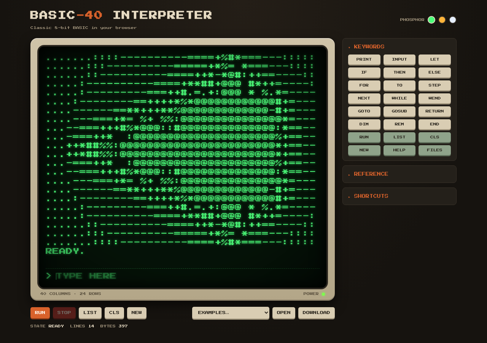

# BASIC-40 Interpreter

[](https://github.com/cstroie/basic/actions/workflows/test.yml)

A classic 8-bit style BASIC interpreter that runs entirely in the browser. It has a 40×24 character CRT screen with green, amber and white phosphor themes. There are no dependencies and no build step.

**Live demo: https://cstroie.github.io/basic/**



## Usage

Open `index.html` in a browser. No server or build step is needed.

- Type a numbered line (`10 PRINT "HI"`) to store it. A bare line number (`10`) deletes that line.
- Type a line without a number to run it immediately (`PRINT 2+2`, `FOR I=1 TO 3:PRINT I:NEXT`).
- Use the **Examples** menu to load a sample program, then type `RUN`.
- Press `Esc` or `Ctrl+C`, or click **STOP**, to break a running program. `CONT` resumes it.
- `↑`/`↓` scroll through command history. Pasting a multi-line listing enters every line.
- **OPEN** / **DOWNLOAD** read and write `.bas` files. You can also drop a `.bas` file on the screen.
- The current program is saved automatically and restored on your next visit.
- **SHARE** copies a link with the program packed into the address. Opening the link loads that program.

## Language

| Area | Supported |
|------|-----------|
| Commands | `RUN [line]`, `LIST [a-b]`, `NEW`, `CLS`, `CONT`, `CLEAR`, `SAVE name`, `LOAD name`, `KILL name`, `FILES`, `HELP` |
| Statements | `PRINT` (`;` `,` `TAB()` `SPC()`, `PRINT AT row,col;`), `INPUT ["prompt";] a, b$`, `LET` (optional), `IF … THEN … ELSE`, `FOR … TO … STEP` / `NEXT`, `WHILE` / `WEND` (or `END WHILE`), `EXIT [FOR\|WHILE]`, `GOTO`, `GOSUB` / `RETURN`, `ON x GOTO/GOSUB`, `DIM`, `READ` / `DATA` / `RESTORE`, `END`, `STOP`, `REM` / `'`, `?` (short for `PRINT`) |
| Functions | `ABS SGN INT SQR SIN COS TAN ATN LOG EXP RND PI LEN VAL ASC CHR$ STR$ LEFT$ RIGHT$ MID$ INSTR UCASE$ LCASE$ STRING$` |
| Operators | `+ - * / ^ MOD`, `= == <> < > <= >=`, `AND OR NOT`, `+` joins strings |
| User functions | `DEF FNA(X) = …`, `DEF FNB$(A$, N) = …` |
| Keyboard and time | `INKEY$` (non-blocking), `GET k$` (waits for a key), `SLEEP seconds` |
| Colour and graphics | `COLOR fg[,bg]` (0–15, C64 palette; −1 is the default), `PLOT x,y`, `DRAW x,y`, `CIRCLE x,y,r`, `GCLS` on a 320×240 canvas over the text |
| Sound | `SOUND hz,ms`, `BEEP` |
| Editing | `RENUM [start[,step]]`, `AUTO [start[,step]]` (an empty line ends it), `EDIT line` |
| Options | `OPTION CLASSIC` prints numbers with MS BASIC spacing; `OPTION COMPACT` (default) doesn't |

- Separate statements on one line with `:`.
- Variables whose names end in `$` hold strings. Arrays can be indexed with `A(i)` or `A[i]`, and an array used without `DIM` gets 0..10.
- `SAVE`/`LOAD` store programs in the browser's localStorage. The name can be quoted or not.

## Examples

The menu on the page has eleven built-in programs, including Graphics & Colour and Keyboard & Sound. The same programs, plus the original `primes.bas`, are in [`examples/`](examples/) as plain `.bas` files. Load one with **OPEN** or by dropping it on the screen.

| File | Shows |
|------|-------|
| `hello.bas` | `PRINT`, `TAB`, `FOR` loops |
| `primes.bas` | `WHILE … END WHILE`, `EXIT`, arrays with `[ ]`, `==` |
| `primes-while.bas` | the same algorithm in `WEND` style with `INPUT` |
| `factorial.bas` | `INPUT` loop, `END` |
| `guess.bas` | `RND`, `IF … THEN … : GOTO` |
| `sine.bas` | `SIN`, `STEP`, text plotting |
| `fizzbuzz.bas` | `MOD`, print zones with `,` |
| `strings.bas` | `MID$`, `UCASE$`, `LEN`, `IF … ELSE` |
| `sort.bas` | `DIM`, `READ` / `DATA`, nested loops |
| `graphics.bas` | `COLOR`, `PLOT`, `DRAW`, `CIRCLE` |
| `keys.bas` | `GET`, `SOUND`, `DEF FN`, `INSTR` |
| `mandelbrot.bas` | `PRINT AT`, `WHILE`, `AND`, `MID$` |

## Install and offline use

The page is a Progressive Web App. Your browser offers to install it (on a phone, use **Add to Home Screen**). After the first visit it also works offline: a service worker (`sw.js`) caches the app and refreshes it in the background, so updates appear on the next visit.

## Layout

- `basic.js` holds the interpreter core: tokenizer, expression parser, statement executor, character-grid terminal and example programs. It does not touch the DOM, so it can also run under Node.
- `index.html` holds the user interface.
- `examples/` holds sample programs.

To try the core without a browser:

```js
const { Basic, Terminal } = require('./basic.js');
const storage = { get: () => null, set: () => true, remove() {}, keys: () => [] };
const b = new Basic(new Terminal(), storage);
b.enter('FOR I=1 TO 3:PRINT I*I:NEXT');
b.runSlice();
console.log(b.term.lines().join('\n'));
```

## Tests

```
node --test
```

The tests run the interpreter core under Node (version 18 or later) with no dependencies. GitHub Actions runs them on every push.

## License

[MIT](LICENSE) © Costin Stroie
